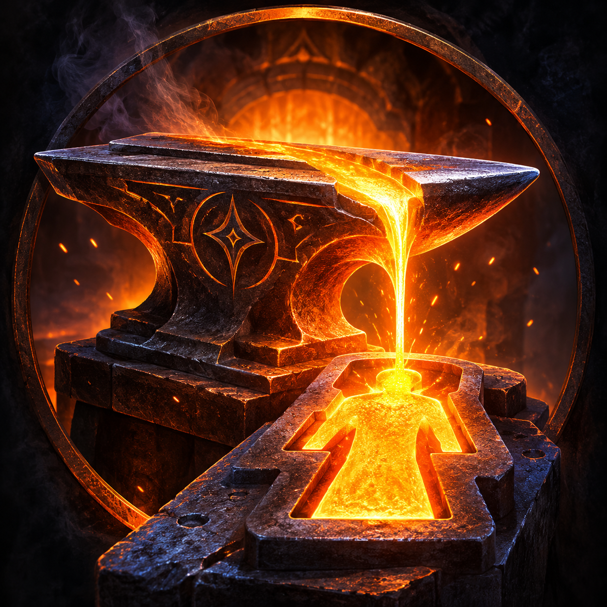

# EFMA – Ember ForgeMind Adventures
 
 

  

**Forge characters. Shape worlds. Create adventures.**

EFMA (Ember ForgeMind Adventures) is an open-source, AI-powered roleplaying and storytelling platform currently under development.

The goal is to create an alternative to [SillyTavern](https://github.com/SillyTavern/SillyTavern), with a stronger focus on RPG-style character management, immersive storytelling, and persistent game worlds.

Rather than treating characters as simple chat profiles, EFMA aims to provide structured RPG-style character sheets, allowing users to manage everything from appearance, personality, and equipment to attributes, skills, relationships, and more.

## Planned Features

- **RPG-style Character Sheets** – Detailed, structured character profiles with customizable sections and attributes.
- **Scenarios & Locations** – Create reusable scenarios and locations, including hierarchical locations with sublocations.
- **Flexible Roleplay Sessions** – Play with multiple characters, designate a player character, and optionally select a scenario and starting location.
- **Persistent Sessions** – Keep track of story progression, character state, inventory, relationships, and other session information.
- **LLM Integration** – Connect to local and remote language models through services such as Ollama, KoboldCpp, and compatible APIs.
- **Multi-user Support** – Give each user their own characters, scenarios, locations, library, settings, and add-ons.
- **Add-on System** – Extend the application with user-specific add-ons that can introduce new features, RPG mechanics, interface components, and content.
- **Desktop & Browser Support** – Run EFMA as a standalone desktop application or access it through a web browser.
- **Import & Export** – Support importing and exporting characters and other content to make it easier to move between platforms.

## Technology

The planned architecture is built around:

- Python and FastAPI for the backend.
- React and TypeScript for the frontend.
- PySide6 and Qt WebEngine for the desktop application.
- SQLite initially, with support for more advanced database setups as the project evolves.
- Pinokio for installation and application launching.

These technologies and implementation details are subject to change during development.

## Project Status

🚧 **UNDER CONSTRUCTION** 🚧

EFMA is currently in the planning and early development stage.

Features listed above represent the project's goals and planned direction. They are not necessarily implemented or available yet.

Expect significant changes as the project develops. Contributions, ideas, and feedback will be welcome as the project progresses.

## Vision

The vision behind EFMA is to create a flexible platform where users can build characters, create stories, explore locations, and experience evolving RPG adventures with the help of AI.

The aim is to go beyond traditional AI chat-based roleplay by combining character creation, RPG mechanics, world-building, and storytelling into one extensible platform.

**Forge characters. Shape worlds. Create adventures.**
